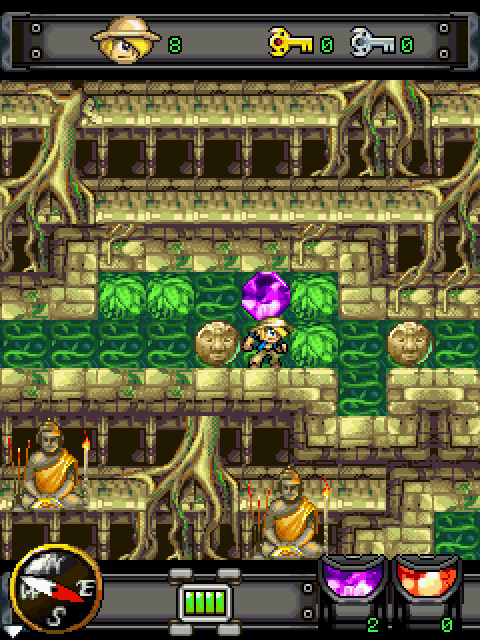

# j2me-web

[简体中文](README.zh-CN.md)

Run J2ME MIDlets in modern browsers.

j2me-web combines a single-threaded Rust/WebAssembly JVM with browser platform
adapters for canvas rendering, input, audio, networking, and persistent RMS
storage. It supports MIDP/LCDUI applications, M3G (JSR-184) content, and a
selection of common device extensions.

> This project is a compatibility runtime, not an implementation of a Java ME
> device or a source of MIDlet archives. Bring your own JAR files and ensure
> you have the right to use them.

## Getting started

Install the browser package:

```sh
pnpm add j2me-web
```

Create a canvas, load a MIDlet JAR, and start the runtime:

```ts
import { J2MEWeb } from 'j2me-web';

const canvas = document.querySelector<HTMLCanvasElement>('#game');
if (!canvas) throw new Error('Missing game canvas');

canvas.width = 240;
canvas.height = 320;

const response = await fetch('/midlets/example.jar');
if (!response.ok) throw new Error(`Could not load JAR: ${response.status}`);

const j2me = new J2MEWeb({
  canvas,
  jar: await response.arrayBuffer(),
  midletId: 'example',
});

await j2me.start();
```

Pass a `<canvas>` and JAR data to `J2MEWeb`.

## Technology

- A Rust J2ME JVM compiled to WebAssembly, with Java threads cooperatively
  scheduled on a single thread.
- A TypeScript browser adapter for Canvas, keyboard and pointer input, fonts,
  networking, and audio.
- WebGPU rendering for LCDUI graphics and M3G / JSR-184 3D content.
- IndexedDB-backed RecordStore (RMS) persistence.

## Highlights

### 3D support

j2me-web renders JSR-184 M3G content with WebGPU, and includes an evolving
Mascot Capsule / Micro3D compatibility layer.

### Live save states

Save and restore a running MIDlet without restarting it. In addition to
portable save-state data, j2me-web supports fast in-memory rewind snapshots for
instant rollback during an active session.

## Supported functionality

| Area | Support |
| --- | --- |
| Java runtime | CLDC 1.1-style classes, JVM bytecode execution, cooperative Java threads, synchronization, resource loading, and garbage collection. |
| MIDP UI | MIDP 2.0 / LCDUI forms, lists, commands, `Canvas`, `GameCanvas`, text/date input, images, fonts, and pointer/key events. |
| Runtime control | Keyboard/pointer input injection, pause/resume, screenshots, performance metrics, network interception, and soft-key label callbacks. |
| Storage and networking | IndexedDB-backed RecordStore and `fetch`-based HTTP requests, with optional host interception. |
| Media | Mobile Media playback paths and browser audio. Codec support and autoplay behavior depend on the browser. |
| Device extensions | Nokia UI, DirectGraphics, sound, vibra, and related extensions. Bluetooth is an opt-in host bridge supplied by the embedding application. |

## Browser requirements

j2me-web is a browser-only runtime. It has no Canvas 2D, WebGL, or non-WebGPU
rendering fallback.

| Requirement | Used for |
| --- | --- |
| Secure context and WebGPU | Required renderer: `navigator.gpu`, `GPUCanvasContext`, and a WebGPU adapter/device. In practice, serve over HTTPS (or use `localhost`). |
| WebAssembly and `fetch` | Loading and running the Rust/WASM JVM. The JAR and package assets must be fetchable. |
| DOM, `HTMLCanvasElement`, and Canvas 2D | The host canvas, font measurement, image conversion, and native text/date input overlays. |
| `MessageChannel` and `performance.now()` | Runtime scheduling and timing. |
| IndexedDB | RMS persistence. If storage is unavailable, RMS operations degrade to empty reads / failed writes. |
| Web Audio API and `HTMLAudioElement` | Audio playback. MIDI additionally requires `AudioWorklet`; browser autoplay policies require a user gesture before sound can start. |

### Screenshots

| LCDUI game | M3G game |
| --- | --- |
|  |  |

## License and notices

This repository is licensed under the [MIT License](LICENSE). Notices for
retained third-party source and assets, including the M3G core headers, are in
[`THIRD_PARTY_NOTICES.md`](THIRD_PARTY_NOTICES.md).
